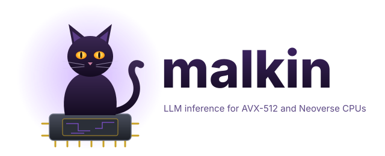

<p align="center">
  <picture>
    <source media="(prefers-color-scheme: dark)" srcset="docs/logo.svg">
    
  </picture>
</p>

<p align="center"><b>Two CPU families. Nothing else.</b><br>
AVX-512 (Zen 4 / Zen 5, EPYC 9004/9005, Sapphire Rapids+) · Arm Neoverse-N1+ · one <code>docker run</code> · OpenAI and Anthropic API</p>

<p align="center">
  
  
  
  
</p>

**malkin is an LLM server for CPUs, built for two instruction sets only:** x86-64 with AVX-512 VNNI + BF16, and Armv8.2-A with dotprod (Neoverse-N1 and newer). Weights are repacked at load into panels for the CPU's dot-product instruction; prompt reading runs as a register-blocked VNNI GEMM, generation can verify draft tokens losslessly. On any other CPU it exits with the list of missing features.

### Measured on one Ryzen 7 9800X3D

| Qwen3, tokens/s, 8 threads | malkin prompt | llama.cpp prompt | | malkin answer | llama.cpp answer |
| --- | ---: | ---: | ---: | ---: | ---: |
| 4B Q8_0 | **502.8** | 121.86 | **4.13x** | 12.55 | 13.46 |
| 4B Q4_K_M | **514.8** | 251.24 | **2.05x** | 21.85 | 21.95 |
| 14B Q6_K | **143.3** | 121.37 | 1.18x | **5.20** | 4.72 |

<!-- [PROV: date=2026-10-29 hw=Ryzen7-9800X3D WSL2 commit=aa79ffb cmd=`tools/bench_vs_llama.sh MODEL 512 32 2` (malkin bench -pp 512 -tg 32 vs llama-bench -p 512 -n 32 -t 8, ghcr.io/ggml-org/llama.cpp:full build 8642541b2), best of 2, back to back, host load 5-8 from other tenants] -->

Prompt = 512-token prefill, answer = 32-token generation, same GGUF file in both engines. Answer speed without a draft model is memory-bound and level with llama.cpp; with a draft model (below) malkin generates the same tokens faster.

**Same quality.** Perplexity on the same text and windows (`malkin ppl` vs `llama-perplexity -c 512`, 2040 tokens): 4B Q8_0 18.0197 vs 18.0256, 4B Q4_K_M 18.2418 vs 18.1540 (llama.cpp's error bar: ±1.41).

**Speculative decoding, lossless.** `--draft qwen3-0.6b-q8_0.gguf`: the draft proposes tokens, the target checks all of them in one pass. Greedy output is byte-identical to plain decoding; sampled output follows the target's distribution exactly (rejection step, `tests/test_sampler.cpp`). Qwen3-8B Q8_0, 200 tokens: 7.3 -> **12.0 tokens/s** (44 % of drafts accepted).

### Where malkin loses, and what it is not

- **Two ISAs.** No AVX2-only x86, no Apple, no SVE paths yet (Neoverse-V1/V2 run the N1 kernels).
- **Q6_K prompt reading** is 1.18x llama.cpp, not 2x; llama.cpp's Q6_K kernels are its most efficient.
- **One architecture:** Qwen3 dense (`qwen3`). No MoE, no vision, no tool calls yet.
- **One sequence at a time**, with prefix reuse; no batching of concurrent requests.
- **Neoverse numbers are emulated** (`qemu -cpu neoverse-n1`): correct, not benchmarked on hardware.

## Quick start

```bash
docker build -t malkin:local .
docker run --rm -p 127.0.0.1:8080:8080 -v /path/to/models:/models:ro \
  malkin:local --model /models/Qwen3-4B-Instruct-2507-Q8_0.gguf

curl -s localhost:8080/v1/chat/completions -H 'Content-Type: application/json' \
  -d '{"model":"x","messages":[{"role":"user","content":"Hello!"}],"max_tokens":64}'
```

arm64 image from an amd64 host, cross-compiled, no emulation: `docker buildx build --platform linux/arm64 -t malkin:arm64 .`

## What it serves

| Surface | Paths |
|---|---|
| OpenAI | `/v1/chat/completions`, `/v1/completions`, `/v1/models` (SSE streaming, `stream_options.include_usage`) |
| Anthropic | `/v1/messages` (SSE streaming, `thinking` blocks) |
| Ops | `/health` |

Hybrid reasoning models: `<think>` output goes to `reasoning_content` (OpenAI) or a `thinking` block (Anthropic); `chat_template_kwargs.enable_thinking=false` turns it off. The KV of the longest common token prefix with the previous request is reused. Responses carry `timings` (prefill and generation tokens/s, `draft_n`, `draft_n_accepted`).

## Models

| | Supported |
|---|---|
| Architecture | `qwen3` (dense) |
| Weights | F32, F16, BF16, Q8_0, Q4_K, Q5_K, Q6_K |
| Tokenizer | byte-level BPE (`gpt2`), pre-tokenizers `qwen2`, `llama-bpe` |
| Chat format | ChatML (`<|im_start|>`) |
| KV cache | BF16 |

## How it works

| Piece | What it does |
|---|---|
| Panels | 16 weight rows interleaved per 64-byte vector, one `vpdpbusd` lane per row; compact panels (about GGUF size) for generation, wide panels (one byte per weight) for K-quant prompt reading |
| GEMM | 2 panels x up to 6 tokens per call, activations as Q8 blocks of 32 with per-half sums for the K-quant minimum terms; work handed out dynamically per (panel pair, token chunk) |
| Attention | the query heads of one KV head (GQA) share every K/V row load; vectorized exp |
| Threads | one engine thread, one OpenMP pool; physical cores for both phases (prefill 348.1 vs 188.7 tok/s on 16 SMT threads, 9800X3D) |
| NUMA | weights first-touched in parallel at load, so pages spread across EPYC NPS2/NPS4 nodes |

## CLI

```
malkin [serve] --model PATH [--host 0.0.0.0] [--port 8080] [--ctx N] [--threads N] [--threads-batch N]
               [--draft PATH] [--n-draft N]
malkin run     --model PATH -p TEXT [-n 512] [--temp 0] [--no-think] [--draft PATH]
malkin bench   --model PATH [-pp 512] [-tg 128]
malkin ppl     --model PATH -f FILE [--window 512]
```

| Environment | Effect |
|---|---|
| `MALKIN_NO_WIDE=1` | no wide prompt panels (saves about 1 byte per K-quant weight of RAM) |
| `MALKIN_NO_PACK=1` | row-by-row kernels only (A/B reference) |
| `MALKIN_PROFILE=1` | wall time per forward stage at exit |

## Build and test

Toolchain: C++26, LLVM 23 (clang, lld, libc++, libomp), CMake 4.4, Ninja 1.13, all in Docker.

```bash
docker build --target test .                          # x86 kernel + sampler tests (kernels skip without AVX-512 BF16)
docker build --target test --platform linux/arm64 .   # same through qemu, Neoverse-N1 CPU model
tests/api_smoke.sh http://127.0.0.1:8080              # 14 API checks against a running server
tools/bench_vs_llama.sh /path/model.gguf 512 128 2    # malkin vs llama.cpp, back to back
```

## Roadmap

1. Q6_K prompt kernels toward 2x; Neoverse panel GEMM (NEON `sdot` by lane).
2. Long context: adaptive-precision attention after [APA](https://github.com/kekzl/apa) (INT8 cold KV tiles, exact hot tiles).
3. Architectures: `qwen3moe`, Gemma, gpt-oss (MXFP4); tool calling, Jinja chat templates.
4. Concurrent requests (continuous batching).

MIT. Sibling project for NVIDIA Blackwell GPUs: [imp](https://github.com/kekzl/imp).
